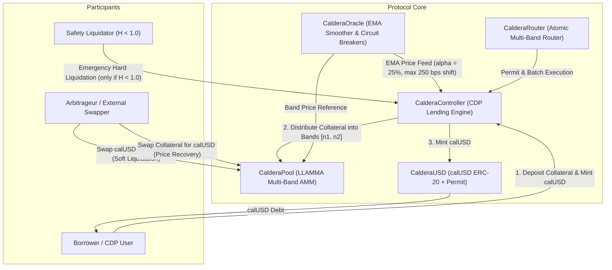

# CalderaLiquid

[](https://github.com/ZengLLQ/caldera-liquid/actions/workflows/ci.yml)
[](https://opensource.org/licenses/MIT)
[](https://soliditylang.org/)
[-ff69b4.svg)](https://eips.ethereum.org/EIPS/eip-1153)
[](https://getfoundry.sh/)

**CalderaLiquid** is a decentralized isolated CDP lending and continuous soft-liquidation AMM (LLAMMA) engine implemented in Solidity 0.8.28 targeting EVM Cancun with EIP-1153 transient storage flash accounting.

Traditional DeFi collateralized debt position (CDP) lending protocols (Compound, Aave, MakerDAO) enforce binary liquidation thresholds: once position collateral value dips below the maintenance limit, third-party liquidators buy out underwater debt in abrupt fire-sale auctions carrying 5% to 15% liquidation penalties. This model incurs severe borrower losses, triggers bad debt cascades during market flash crashes, and incentivizes toxic MEV front-running.

CalderaLiquid eliminates abrupt liquidations through the **Lending-Liquidating AMM Algorithm (LLAMMA)**. Deposited collateral is partitioned into $N$ discrete geometric price bands. As market price declines into a band, external arbitrageurs continuously convert volatile collateral ($X$, e.g. WETH) into synthetic debt tokens ($Y$, `calUSD`). If market price recovers, the AMM converts stable debt tokens back into collateral, rendering liquidations **continuous, smooth, and reversible**.

---

## Architecture Overview



---

## Mathematical Formulation

### 1. Geometric Band Discretization
Given a top reference price $p_{\text{base}}$ and an amplification parameter $A$ (e.g. $A = 50$, multiplier $\frac{A - 1}{A} = 0.98$), each band $n \in \mathbb{Z}$ is bounded by:

$$p_{\text{high}}(n) = p_{\text{base}} \cdot \left(\frac{A - 1}{A}\right)^n$$

$$p_{\text{low}}(n) = p_{\text{high}}(n) \cdot \left(\frac{A - 1}{A}\right) = p_{\text{base}} \cdot \left(\frac{A - 1}{A}\right)^{n+1}$$

### 2. Transformed Constant-Product Invariant
Inside band $n$, the AMM enforces an invariant curve between collateral $x$ (WETH) and synthetic debt $y$ (`calUSD`):

$$(x + x_0)(y + y_0) = K$$

where $x_0$ and $y_0$ are virtual liquidity offsets:

$$x_0 = c \cdot (A - 1)$$

$$y_0 = \frac{c \cdot p_{\text{low}}}{10^{18}} \cdot (A - 1)$$

$$K = c \cdot A \cdot y_0$$

When the price is at or above $p_{\text{high}}$, the band contains 100% collateral ($x = c, y = 0$). As price sweeps downward towards $p_{\text{low}}$, the collateral is converted into debt tokens until $x = 0$ and $y = y_{\text{max}}$:

$$y_{\text{max}} = \frac{c \cdot p_{\text{low}}}{10^{18}}$$

### 3. Continuous Soft-Liquidation Swaps
For incoming collateral $\Delta x$ (price recovery):

$$y_{\text{new}} + y_0 = \frac{K}{x_{\text{curr}} + \Delta x + x_0}$$

$$\Delta y_{\text{gross}} = y_{\text{curr}} - y_{\text{new}}, \quad \Delta y_{\text{net}} = \Delta y_{\text{gross}} \cdot \frac{10000 - f_{\text{bps}}}{10000}$$

For incoming debt tokens $\Delta y$ (soft liquidation as price falls):

$$x_{\text{new}} + x_0 = \frac{K}{y_{\text{curr}} + \Delta y + y_0}$$

$$\Delta x_{\text{gross}} = x_{\text{curr}} - x_{\text{new}}, \quad \Delta x_{\text{net}} = \Delta x_{\text{gross}} \cdot \frac{10000 - f_{\text{bps}}}{10000}$$

### 4. Dynamic Kinked Borrow Rate Model
The protocol adjusts borrow interest rates dynamically according to global debt ceiling utilization $U = \frac{\text{Total Debt}}{\text{Debt Ceiling}}$:

$$r(U) = r_{\text{base}} + \begin{cases} \frac{U}{U_{\text{opt}}} \cdot r_{\text{slope1}} & \text{if } U \le U_{\text{opt}} \\ r_{\text{slope1}} + \frac{U - U_{\text{opt}}}{1 - U_{\text{opt}}} \cdot r_{\text{slope2}} & \text{if } U > U_{\text{opt}} \end{cases}$$

- $r_{\text{base}} = 2\%$ APR
- $U_{\text{opt}} = 80\%$
- $r_{\text{slope1}} = 4\%$ APR ($r(U_{\text{opt}}) = 6\%$ APR)
- $r_{\text{slope2}} = 30\%$ APR ($r(100\%) = 36\%$ APR)

Continuous interest compounding index:

$$I(t + \Delta t) = I(t) \cdot \left(1 + \frac{r(U) \cdot \Delta t}{31,536,000}\right)$$

### 5. Health Factor & Hard Liquidation
Position health factor $H$ measures aggregate portfolio value inside bands relative to maintenance debt:

$$H = \frac{V_{\text{portfolio}}(x, y, P_{\text{oracle}}) \cdot 10000}{\text{Debt} \cdot \text{Threshold}_{\text{liquidation}}}$$

- Under normal market volatility, LLAMMA soft-liquidation converts $X \to Y$, stabilizing $V_{\text{portfolio}} \approx \text{Debt}$ and keeping $H > 1.0$ without penalty.
- If market price collapses below band range $n_2$ before arbitrageurs absorb collateral, or if interest accrues beyond thresholds such that $H < 1.0$, a safety liquidator can extinguish debt and claim remaining assets with a 2% liquidator incentive fee.

---

## Contract Size & Gas Report

Compiled with `solc 0.8.28`, optimizer enabled (`runs = 200`), `via_ir = true`, targeting EVM Cancun:

| Contract | Runtime Size (Bytes) | Spurious Dragon Limit (24,576 B) | Runtime Margin (Bytes) |
|---|---|---|---|
| `CalderaController` | **5,722** | 24,576 | 18,854 |
| `CalderaPool` | **6,577** | 24,576 | 17,999 |
| `CalderaUSD` | **2,267** | 24,576 | 22,309 |
| `CalderaRouter` | **2,014** | 24,576 | 22,562 |
| `CalderaOracle` | **895** | 24,576 | 23,681 |

---

## Project Structure

```
CalderaLiquid/
├── .github/
│   └── workflows/
│       └── ci.yml             # GitHub Actions CI workflow (formatting, build, fuzz tests)
├── script/
│   └── DeployCaldera.s.sol    # Automated Foundry broadcast deployment script
├── src/
│   ├── interfaces/
│   │   ├── ICalderaController.sol
│   │   ├── ICalderaOracle.sol
│   │   ├── ICalderaPool.sol
│   │   └── ICalderaUSD.sol
│   ├── libraries/
│   │   └── BandsMath.sol      # Fixed-point continuous invariant and band calculations
│   ├── CalderaController.sol  # CDP lending manager, kinked rate model, health monitoring
│   ├── CalderaOracle.sol      # EMA price feed with 250 bps circuit breakers
│   ├── CalderaPool.sol        # LLAMMA continuous multi-band AMM engine
│   ├── CalderaRouter.sol      # Permit-enabled borrower & arbitrage router
│   └── CalderaUSD.sol         # Synthetic debt token (calUSD) with EIP-2612 Permit
├── test/
│   ├── mocks/
│   │   └── MockERC20.sol      # Mock collateral token for testing
│   ├── BandsMath.t.sol        # Unit & mathematical property fuzz tests
│   ├── CalderaController.t.sol# Loan lifecycle, borrow rates, and liquidation tests
│   ├── CalderaInvariants.t.sol# Stateful solvency & reversibility fuzzing
│   ├── CalderaOracle.t.sol    # EMA smoothing & circuit breaker verification
│   └── CalderaPool.t.sol      # AMM swaps, band transitions, and reentrancy tests
├── foundry.toml               # Foundry configuration (Cancun, via-ir, fuzz runs = 256)
├── LICENSE                    # MIT License
└── README.md
```

---

## Getting Started

### Prerequisites
- [Foundry](https://getfoundry.sh/) (`forge`, `cast`, `anvil`)
- Git

### Installation & Compilation
```bash
# Clone repository
git clone https://github.com/ZengLLQ/caldera-liquid.git
cd caldera-liquid

# Build smart contracts and verify sizes
forge build --sizes
```

### Running Test Suite
```bash
# Run all unit, integration, and fuzz tests
forge test -vvv --fuzz-runs 256

# Check code formatting
forge fmt --check

# Simulate local deployment
forge script script/DeployCaldera.s.sol
```

---

## Key Features & Security Hygiene

1. **EIP-1153 Transient Storage Reentrancy Guards**:
   Pool swaps and controller state modifications are protected using Cancun native assembly `tstore`/`tload` transient storage opcodes at slot `0x5d`, guaranteeing reentrancy safety while consuming zero cold SSTORE gas.

2. **Reversibility Guarantee**:
   Borrowers do not suffer irreversible liquidation penalties if collateral price dips into their bands and recovers. Continuous AMM invariant trading maintains conservation within swap fee spread.

3. **EMA Smoothing & Circuit Breakers**:
   The oracle applies an Exponential Moving Average ($\alpha = 25\%$) paired with a strict 250 bps max deviation ceiling per block, preventing flash loan spot manipulation from moving liquidation bands.

4. **Zero External Dependencies**:
   All core arithmetic, ERC-20 token standard, Permit signatures, and state transition engines are self-contained without vulnerable transitive third-party dependencies.

---

## Known Limitations & Future Enhancements

1. **Band Index Scaling**:
   Current band price calculations iterate over discrete band offsets $n \in [-500, 500]$. High-frequency production rollouts can incorporate Chebyshev polynomial approximations or 64.64 binary fixed-point exponentiation for $O(1)$ logarithmic execution.
2. **Multi-Collateral Isolation**:
   `CalderaController` manages single-collateral vaults (e.g. WETH / calUSD). Additional controller instances can be deployed for staked ETH (wstETH), WBTC, or real-world assets (RWA).

---

## License

This project is licensed under the [MIT License](LICENSE).
